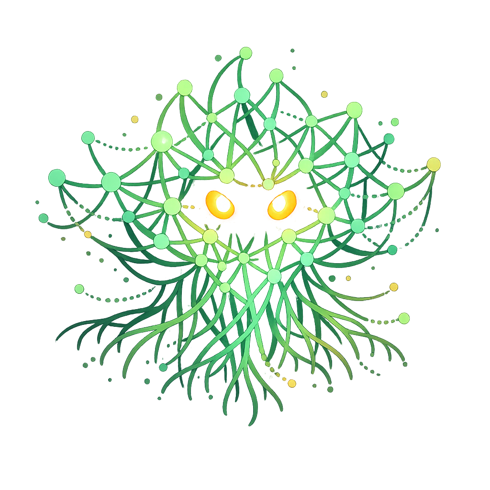
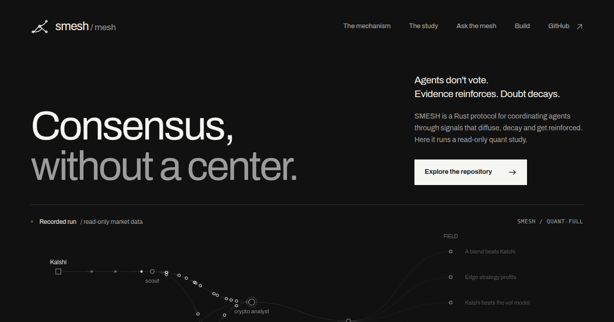

<p align="center">
  
</p>

<h1 align="center">SMESH</h1>

<p align="center">
  <strong>Consensus, without a center.</strong><br/>
  A Rust protocol for coordinating agents through signals that diffuse, decay and get reinforced.
</p>

<p align="center">
  <a href="https://github.com/copyleftdev/smesh-rust/actions/workflows/ci.yml"></a>
  <a href="https://copyleftdev.github.io/smesh-rust/"></a>
  
  
  <a href="#license"></a>
  <a href="https://tokentip.to/@copyleftdev"></a>
</p>

<p align="center">
  <a href="https://copyleftdev.github.io/smesh-rust/"><strong>Website</strong></a> ·
  <a href="#quick-start">Quick start</a> ·
  <a href="#what-you-can-run">What you can run</a> ·
  <a href="#the-workspace">The workspace</a> ·
  <a href="https://youtu.be/PQaowYdPCRE">Demo video</a>
</p>

---

Agents in SMESH don't vote, and nobody routes work to them. They emit **signals** onto a
shared **field**. A signal has an intensity that **decays** over time, so stale tasks and
unsupported claims fade on their own. Agents that agree **reinforce** a signal; one that
nobody reinforces disappears. Whatever is still strong when the field settles is the answer.

The idea comes from mycorrhizal networks, where trees share signals through fungal threads
in the soil and no single tree is in charge.

```
  Agent A emits         the field decays          Agent B senses,
  "need review"         what nobody backs         claims, and reinforces
       │                       │                          │
       ▼                       ▼                          ▼
   ████████▓▓▓▓▒▒▒▒░░░░░░░░░░░░░░░░░░░░░░░░░░░░▒▒▓▓████████

   agreement → reinforcement → consensus      silence → decay → forgotten
```

## See it

<p align="center">
  <a href="https://copyleftdev.github.io/smesh-rust/">
    
  </a>
</p>

**[copyleftdev.github.io/smesh-rust](https://copyleftdev.github.io/smesh-rust/)** replays a
recorded research run. A mesh of agents read Kalshi, Massive and Kraken market data, read-only,
and tested eight hypotheses about Kalshi's prediction markets on windows they had never seen.
Each hypothesis was a signal on a SMESH field. Five reached consensus and three faded:

| Claim | Windows for / against | Strength |
|---|:-:|--:|
| Kalshi's hourly crypto odds are consistent with being calibrated | 8 / 0 | **0.86** |
| Kalshi's implied expectation beats the last print (CPI, payrolls, Fed) | 25 / 8 | **0.65** |
| Kalshi's threshold odds beat climatology | 22 / 7 | **0.45** |
| Kalshi's crypto odds beat a realized-volatility model | 7 / 1 | **0.45** |
| The surprise predicts TLT's direction after a release | 23 / 9 | **0.39** |
| A fee-aware edge strategy profits (−$0.016 a trade) | 4 / 4 | 0.00 |

Consensus means a final strength of 0.30 or more. Research, not trading advice.

A narrated walkthrough of an earlier use, where a mesh adjudicates a pharmacy claim under
signed policy ([AION](https://github.com/aion-context/aion-context)) and escalates to a human
instead of denying coverage on its own: **[▶ SMESH × AION (2.5 min)](https://youtu.be/PQaowYdPCRE)**.

## Quick start

```bash
git clone https://github.com/copyleftdev/smesh-rust
cd smesh-rust
cargo build --release

# Watch signals settle. No LLM, no API key.
cargo run --release --bin smesh -- sim --nodes 50 --ticks 100

# Check the OpenRouter connection
cargo run --release --bin smesh -- status
```

LLM agents read `OPENROUTER_API_KEY`; the Claude backend reads `ANTHROPIC_API_KEY`.
Plain-language routing reads `TYPESAFE_API_KEY` ([Jev](https://docs.typesafe.ai/introduction)).
The quant study reads `MASSIVE_API_KEY`; Kalshi and Kraken need no key for the data it uses.
Every key except `ANTHROPIC_API_KEY` can also live in a dotenv file under `~/.creds/`; the
Anthropic key must be exported. [CLAUDE.md](CLAUDE.md#environment-variables) lists them all.

## What you can run

Everything ships in one binary, `smesh`. Install it with `cargo install --path smesh-cli`
to use the commands below as written, or run each as `cargo run --release --bin smesh -- <args>`.
`smesh --help` lists them all. Servers and nodes keep running, so start each in its own terminal.

### Agents, in any domain, behind one A2A endpoint

```bash
# The whole mesh is one A2A v1.0 agent. Describe agents in plain language;
# each asks Jev whether it suits a task, and the field settles who takes it.
# Local agents need OPENROUTER_API_KEY as well as TYPESAFE_API_KEY.
smesh a2a serve --jev \
  --agent "Translator=a translator between English and Portuguese" \
  --agent "Contracts=a reviewer of commercial contracts who flags risky clauses"

smesh a2a send --url http://127.0.0.1:7410 "Translate into Portuguese: the evidence decides."
smesh a2a card http://127.0.0.1:7410          # its Agent Card, signed when served with --sign-key

# A mesh of remote A2A agents only (--agents 0 starts no local ones)
smesh a2a serve --agents 0 --recruit http://other-agent:9000
```

### Agents with tools

Give agents tools from any [MCP](https://modelcontextprotocol.io) server, or write them in Rust.
Each agent gets its own allowlist and a **clearance** (`read` < `write` < `execute`): a tool above
it is never offered to the agent and never run for it. An agent's tools count toward which tasks
it suits, so the agent holding the right tool is the one that claims the task. When two agents
suit a task about equally (within 10 points), the less privileged one takes it: a read-only agent
answers questions even if a write-capable one scored a little higher. Every call is journaled, and
over A2A each call is reported as a status update.

```bash
smesh tools example > smesh.tools.toml   # a starter config: servers, agents, clearances
smesh tools list                         # what each agent may use, and what its clearance hides
smesh tools ask "How many days until the offsite in our files, and where is it?"
#   · Scribe (write) judges its fit at 81%
#   · Librarian (read) judges its fit at 76%
#   → Librarian takes it: within 10 points of Scribe's 81%, and less privileged
#     ✓ files__list_directory_with_sizes {"path":"…"}
#     ✓ files__read_text_file {"path":"…/offsite.md"}
#     ✓ builtin__now {}
#   Offsite date: 2026-12-04, 24 days from today. Venue: the greenhouse on Pier 3.

smesh a2a serve --jev --tools smesh.tools.toml   # the same agents, behind one A2A endpoint
```

```toml
[servers.files]                  # an MCP server over stdio; `url = "…"` for streamable HTTP
command = "npx"
args = ["-y", "@modelcontextprotocol/server-filesystem", "."]

[[agents]]
name = "Librarian"
capability = "a librarian who answers questions from the files in this directory"
tools = ["files.read_*", "files.list_*", "builtin.now"]
clearance = "read"               # the default; unannotated MCP tools count as write
```

Agents with tools default to `openai/gpt-5-mini` (set `model` per agent): in live runs, lighter
models guessed file names or wrote summaries of files they never opened.

### A read-only research mesh

```bash
smesh quant run --track both --out runs/quant-mine   # walk-forward study, every step journaled
smesh quant export-site --run runs/quant-mine --out site/data
smesh a2a serve --jev --agents 0 --quant-run runs/quant-mine   # ask the finished study questions
```

The market-data client can only issue `GET`s to an allowlist of public market-data paths.
There is no code path to an order, a cancel or a wallet.

### A live peer-to-peer mesh

```bash
smesh mesh --name a --bind 127.0.0.1:7001 --identity a.key --duration 0   # terminal 1
smesh mesh --name b --peer 127.0.0.1:7001 --emit "hello, field"           # terminal 2
```

Nodes talk over QUIC and sign what they send. Each node pins a peer's key the first time it
sees that name (trust on first use, held in memory), and refuses the same name later presented
with a different key. Pins reset when a node restarts.

### More

| Command | What it does |
|---|---|
| `smesh agents --demo` | LLM agents coordinating through signals |
| `smesh review --path ./repo` | Multi-agent code review: security, performance, style, docs |
| `smesh code` | A coding swarm: architect, coders, tester, reviewer, with trust that moves |
| `smesh resilience` | The mesh under node failure, eclipse and Byzantine attacks |
| `smesh owasp` | The mesh scored on the OWASP Benchmark v1.2 |
| `smesh adjudicate` | Pharmacy claims against signed AION formulary policies |
| `smesh showcase` | The kinetic showcase from the demo video, at <http://localhost:8090/?tour=1> |
| `smesh viz` | The signal field, live in a browser |
| `smesh bench` / `smesh sim` | Signal benchmarks and simulations |
| `smesh redteam`, `fullscan`, `bounty`, `swarm` | Security swarms, for **authorized** testing only |

## The workspace

| Crate | What it holds |
|---|---|
| [`smesh-core`](smesh-core) | Signals, nodes, fields, network topologies, Bayesian trust |
| [`smesh-runtime`](smesh-runtime) | The QUIC peer-to-peer mesh, with signed attestation |
| [`smesh-agent`](smesh-agent) | LLM backends (OpenRouter, Claude), Jev routing, tools (MCP + Rust) with clearance gates |
| [`smesh-a2a`](smesh-a2a) | The mesh as an A2A v1.0 agent; remote A2A agents as members; signed Agent Cards |
| [`smesh-quant`](smesh-quant) | The read-only research mesh, its journal and the site export |
| [`smesh-world`](smesh-world) · [`smesh-refinery`](smesh-refinery) · [`smesh-ratify`](smesh-ratify) | Signed organizational world models, with a human as merge authority ([design](WORLD-MODEL.md)) |
| [`smesh-bounty`](smesh-bounty) | Security swarms; its sandboxed tools are ordinary mesh tools (`bounty_tools`) |
| [`smesh-cli`](smesh-cli) | The `smesh` binary |

438 tests pass across the workspace (`cargo test --workspace`); one live evaluation against
Jev is `#[ignore]`d and runs on demand.

## How it differs from an orchestrator

| | A central orchestrator | SMESH |
|---|---|---|
| Who assigns work | The orchestrator | Agents claim it; stronger claims win, weaker ones back off |
| How agreement forms | A vote or a fixed pipeline | Reinforcement; what nobody backs decays |
| When a member fails | The step or chain fails | Its signals fade and others pick the work up |
| How members join | Registered in the graph | Any agent that can sense the field, including any A2A agent |

**A good fit:** several agents with overlapping skills; work where stale tasks should expire on
their own; evidence that accumulates over time; meshes that lose and gain members.

**Not a fit:** a single chatbot; strictly ordered pipelines; anything that needs exactly-once delivery.

## Performance

Measured with `cargo bench -p smesh-core` (Criterion, release build, one workstation):

| Operation | Time |
|---|--:|
| Reinforce a signal | 63 ns |
| Create a signal | 312 ns |
| Tick a 100-signal field | 10 µs |
| Tick a 100-node small-world network | 28 µs |

The LLM call, not the protocol, is almost always the slow part.

## Further reading

- [WORLD-MODEL.md](WORLD-MODEL.md): signed organizational world models with SMESH and AION
- [ARTICLE.md](ARTICLE.md): how a walk in the woods led to this
- [CLAUDE.md](CLAUDE.md): commands, environment and key files, for contributors and coding agents
- [site/llms.txt](https://copyleftdev.github.io/smesh-rust/llms.txt): the website, for agents

## License

Dual-licensed under [MIT](LICENSE-MIT) or [Apache-2.0](LICENSE-APACHE), at your option.
